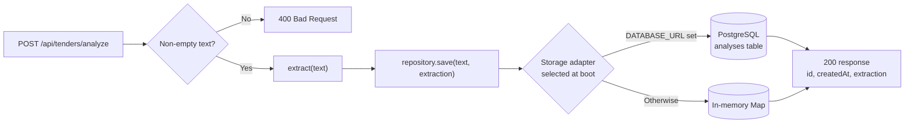

# Backend Challenge — Vantedge Bid

A single REST API endpoint that receives tender text, runs a simple
keyword-extraction simulation, and stores the extraction result.

## Tech stack

- Node.js 22 / TypeScript / Express
- PostgreSQL (optional; in-memory storage by default)

## Endpoint

- `POST /api/tenders/analyze` accepts JSON `{ "text": "..." }` with non-empty text.
- Returns 200 with `{ id, createdAt, extraction: { keywords, tenderTerms, deadlines, budgets } }`.
- Returns 400 for invalid text, 500 for storage errors. No authentication or file upload.

Extraction is deterministic keyword/term/date/budget matching, not an LLM.

## Flow



The request path is identical for both storage modes; only the injected
repository differs.

## Folder structure

```
src/
  config/        # environment and app configuration
  routes/        # HTTP routes only
  services/      # extraction logic (pure, no database access)
  repositories/  # storage interface and implementations
  db/            # database client (PostgreSQL / Supabase)
  types/         # shared types
test/            # tests
sql/             # database schema
infrastructure/  # local Compose stack
Dockerfile       # API container image
```

## Storage

The HTTP route calls a pure extraction service and an injected repository interface.
When `DATABASE_URL` is set, the Postgres adapter stores analyses in the `analyses`
table; otherwise the app uses in-memory storage (cleared on restart). The
Postgres schema is created at startup using `sql/schema.sql`.

## How to run

Requires Node.js 22 and npm. From the repository root:

```sh
npm ci
npm test
npm run build
npm start
```

To run the API and PostgreSQL in containers instead:

```sh
docker compose -f infrastructure/docker-compose.yml up --build
```

The API is at `http://localhost:3000`; Postgres is exposed on localhost:5432.
The Compose credentials are for local development only. For an external
Postgres server, set `DATABASE_URL` (see `.env.example`) and run `npm start`.

```sh
curl -X POST http://localhost:3000/api/tenders/analyze \
  -H 'Content-Type: application/json' \
  -d '{"text":"Pembangunan gedung anggaran Rp 1.500.000.000 batas 12 Desember 2026"}'
```
